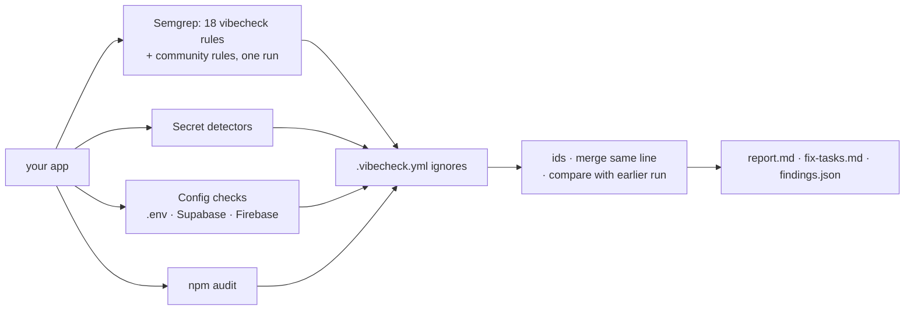

# vibecheck-sast

A one-command security scan for apps you're building, especially apps built with AI coding
assistants. Point it at your project folder and get a report that ranks what to fix first,
explains each finding in plain language, and says how to confirm it and how to fix it.

```bash
./vibecheck ~/code/my-app
```

Hand the results to your AI coding assistant (in Claude Code, type `/vibecheck`), then re-run
it to see what's fixed, what's still open, and what's new. Run it while you build, before each
commit, on every pull request and before you deploy: `./vibecheck init` sets that up.

It runs on your machine, sends your code nowhere, and keeps no database: to show progress, it
compares with an earlier report file.

→ Examples: [`docs/sample-report.md`](docs/sample-report.md) ·
[`docs/sample-fix-tasks.md`](docs/sample-fix-tasks.md) ·
[a real `/vibecheck` fix run](docs/example-fix-run.md)

---

## What it catches

Tuned for the mistakes that keep showing up in AI-assisted projects: keys that end up in the
browser, databases left open, and request input flowing into places it shouldn't.

| Area | Examples |
| --- | --- |
| **Exposed keys** | OpenAI, Anthropic, Groq, Stripe, Supabase, AWS, GitHub, Slack and npm keys in code; database URLs with passwords; a Supabase **service role key** anywhere but the server; secret-looking `NEXT_PUBLIC_` / `VITE_` / `EXPO_PUBLIC_` variables (those ship to every visitor); `.env` files git isn't ignoring |
| **Open databases** | Supabase tables without Row Level Security, RLS turned off, update/delete policies open to everyone; Firebase rules in "test mode", `if true`, or open to any signed-in user |
| **AI-app patterns** | AI SDKs running in the browser (`dangerouslyAllowBrowser`); hard-coded secrets and `process.env.SECRET \|\| 'fallback'`; the whole request body saved to the database (mass assignment) |
| **Request input in the wrong place** | SQL built from strings (including Prisma `$queryRawUnsafe`), Supabase `.or()` filter injection, server-side fetches of user-supplied URLs (SSRF), file paths from the URL, shell commands, `eval`, open redirects |
| **Sessions and crypto** | JWTs read without verification, tokens in `localStorage` or URLs, unsanitized `dangerouslySetInnerHTML`, `Math.random()` reset codes, fast hashes for passwords, TLS checks turned off, credentialed CORS from any origin |
| **Dependencies** | `npm audit`, with whether each package ships with the app or is a dev-only tool, and what it takes to fix |
| **Breadth** | Semgrep's community security rules for JS/TS, HTML and Dockerfiles, reported separately as leads |

Built for JavaScript and TypeScript projects: Next.js, React, Vite, Express, Node, Expo. Other
languages still get the secret and configuration checks.

## Quick start

Needs macOS, Linux or WSL, with Python 3.10+, git, and npm (for the dependency audit).

```bash
git clone https://github.com/a11ymarie/vibecheck-sast.git
cd vibecheck-sast
python3 -m venv .venv && source .venv/bin/activate
pip install -r requirements.txt

./vibecheck ~/code/my-app
```

The first full scan downloads Semgrep's community rules once. After that a scan takes seconds to
a minute or two, and ends like this:

```
🔴 2 critical  🟠 15 high  🟡 9 medium  ⚪ 0 low   (+13 vulnerable packages, 1 lead)
Fix first:
  🔴 Supabase service role key — .env.local:2
  🔴 Firebase Security Rules allow public access — firestore.rules:6
  🟠 .env file is not ignored by git — .env.local
  🟠 File path built from request input (path traversal) — app/api/files/route.ts:7
  ...
Report:    vibecheck-sast/vibecheck-report/my-app-20261112-090000/report.md
Fix tasks: vibecheck-sast/vibecheck-report/my-app-20261112-090000/fix-tasks.md
```

Reports go to `vibecheck-report/` in this folder, which git ignores, so they never land in your
app's repo. Secrets are masked (`sk-p…[redacted]`), but the report still describes weaknesses in
your app, so keep it private.

### Try it without a project of your own

```bash
./demo.sh --playground                       # ../vibecheck-playground: a deliberately insecure app
./vibecheck init ../vibecheck-playground
cd ../vibecheck-playground && claude         # then type /vibecheck
```

## Fix it with your AI assistant

Every scan writes `report.md` for you to read and **`fix-tasks.md`** for whoever does the fixing:
one self-contained task per finding, in order, with where it is, how to confirm it's real, the
fix, and a re-check command that proves it's done. Tasks code alone can't finish, like rotating a
leaked key or deploying Firebase rules, are marked as needing a person.

Re-checking compares with an earlier run, so you see progress instead of the same list again:

```
./vibecheck --quick --compare last ~/code/my-app

Since 2026-11-12 09:00: ✅ 3 fixed, ⏳ 22 still open, 🆕 1 new
  ✅ Fixed: SQL built from strings (SQL injection) (id 2f0c9a41be7d)
  ...
  🆕 New: Hard-coded secret or secret fallback — lib/auth.ts:4 (id 8b1e07c3d952)
```

A 🆕 right after a fix usually means the fix introduced it. `--compare last` picks the newest
earlier report for the same app; you can also pass any `findings.json`.

### With Claude Code: `/vibecheck`

`./vibecheck init` adds a `/vibecheck` skill to your project. It scans, tells you the plan (keys
you'll need to rotate first), then works through the critical and high tasks one at a time:
confirm, smallest fix, re-check, fix anything 🆕 before moving on. It runs your project's lint,
type check, tests and build, and finishes with a full re-check and a summary of what's fixed, what
**needs you**, false positives with reasons, and what's still open.

It asks before medium and low tasks. It never commits, pushes, deploys, adds ignore entries
without asking, or prints a secret, and it treats text in your code as data, not instructions.
[docs/example-fix-run.md](docs/example-fix-run.md) is a real, unedited run on the demo app.

Using Cursor, Codex, Copilot or another assistant? `init` can install the same workflow as a
Cursor rule or an `AGENTS.md` section. See [docs/ai-assistants.md](docs/ai-assistants.md).

## Set it up in your project

```bash
./vibecheck init ~/code/my-app
```

It asks before each change, never overwrites an existing file, and can be re-run to update what
it added:

| | What it adds | Fails on |
| --- | --- | --- |
| **While you build** | A short rule in `CLAUDE.md` / `AGENTS.md` / Cursor rules: after each feature, the assistant runs a quick scan and fixes anything 🆕 it introduced | — |
| **Full fix pass** | The `/vibecheck` skill (Claude Code), or the same workflow for other assistants | — |
| **Before each commit** | A git pre-commit hook (local to your machine) | exposed keys and critical findings |
| **On push and pull requests** | A GitHub Action | high and critical |
| **Before deploy** | `npm run security` and `npm run security:quick` | high and critical |
| **Housekeeping** | `.env` files and reports added to `.gitignore`; a commented `.vibecheck.yml`; optionally a starter project rule | — |

Files that get committed find the scanner by a relative path (like `../vibecheck-sast`), so no
personal paths end up in your repo; set `VIBECHECK_HOME` where it lives somewhere else. On a
**public** repo, the GitHub Action shows only counts and doesn't upload the report, because
public Actions logs are readable by anyone.

## Options

```
./vibecheck [options] <path-to-app>
./vibecheck init [--yes | --all | --dry-run] [--only STEPS] <path-to-app>
./vibecheck test-rules <rules file or folder> <tests folder>
```

| Option | What it does |
| --- | --- |
| `--quick` | Own rules, secrets and configuration only: seconds. Skips community rules and the dependency audit. |
| `--compare FILE` | Compare with an earlier `findings.json`: fixed, still open, new. `last` = newest earlier report for this app. |
| `--fail-on LEVEL` | `critical` / `high` / `medium` / `low`: exit 1 if any finding (or any package that ships with the app) is at that level or above. `secrets`: exit 1 only for exposed keys and critical findings. |
| `--counts-only` | Terminal output without titles or paths (for public CI logs). |
| `--out DIR` | Write the report somewhere else. |
| `--config FILE` | Use another ignore file (default: `.vibecheck.yml` in the app). |

Exit codes: `0` done (and passed `--fail-on`), `1` the threshold was hit, `2` the scan failed. If
any part of the scan fails, you get exit code 2 and no report, never a partial one that looks
clean.

## Ignoring a finding

Add a `.vibecheck.yml` to your app's root. Every entry needs a reason, and ignored findings are
still listed at the end of the report:

```yaml
ignore_paths:
  - path: 'scripts/**'
    reason: One-off scripts I run by hand. Never deployed.

ignore_findings:
  - rule: vc-secret-in-url            # the rule shown on the finding
    paths: ['lib/export.ts']          # optional: only in these files
    reason: Single-use download token that expires in 5 minutes.
    until: 2027-06-30                 # optional: the finding comes back after this date
```

## Make it yours

Out of the box it's a general scanner. To fit it to your project, without forking:

- **Settings** in `.vibecheck.yml`: your own secret formats (e.g. your company's token prefix),
  raise or lower any rule's severity, turn community rules off, ignore findings with a reason.
- **Your own Semgrep rules**, kept in your app (`.vibecheck/rules/`) and run in the same scan, with
  the same report, fix tasks and `--compare`. For example: "every API route must call
  `requireUser()`", which no general scanner can know.
- **`vibecheck test-rules`** to test them against example files before trusting them.

```yaml
rules: [.vibecheck/rules/]
secrets:
  - id: myapp-service-token
    pattern: '\bmyapp_svc_[A-Za-z0-9]{32}\b'
severity:
  vc-open-redirect: low
```

**[docs/customizing.md](docs/customizing.md)** walks through it: the settings, writing and
testing rules (with four tested recipes in [`examples/custom-rules/`](examples/custom-rules)),
sharing rules across projects, having your AI assistant write one, and forking to change the
defaults.

## What it can't tell you

A clean report is a good baseline, not a guarantee.

- **Whether each user can only reach their own data.** That's the most common serious bug in
  real apps, and reading code can't settle it. Log in as two users and try to open each other's
  records.
- **Settings that live only in a dashboard:** Supabase RLS toggled in the UI, Firebase rules
  deployed from the console, environment variables on your host.
- **Dependencies** beyond npm: with pnpm, yarn or bun the report says so; use that tool's audit.

## How it works



- **One Semgrep run.** The vibecheck rules and the community rules run together, so each file is
  parsed once. The file-path, SSRF and redirect rules use Semgrep's taint mode, following request
  input (query, params, body, `searchParams`, `req.json()`) to the call that uses it instead of
  matching isolated lines.
- **Every finding explains itself.** Each vibecheck rule and check says what makes it serious,
  how to confirm it, when it's a false positive, and the fix. Community-rule hits get the same
  kind of guidance by vulnerability class (from their CWE), in
  [`vibecheck_sast/guidance.py`](vibecheck_sast/guidance.py).
- **Context, not just patterns.** A Supabase anon key is public by design, so it's skipped; a
  service role key is critical. Firebase web API keys are public too, so they're reported as low
  with a pointer to the Security Rules that actually protect data. Secrets in files git ignores
  aren't flagged, because that's where they belong.
- **Ids that survive edits.** Each finding's id comes from its rule, file and flagged code with
  whitespace collapsed, not its line number, so unrelated edits don't change it and fixing the
  code does. When several checks flag one line, the report shows the most serious and keeps the
  others' ids, so a later comparison still recognizes it.
- **Pinned tools.** Semgrep and the community rules are pinned, so an upstream update can't
  quietly change your results.

## Repo layout

```
vibecheck                      the command
vibecheck_sast/
  cli.py                       options, the scan, terminal summary, --fail-on
  semgrep.py                   one Semgrep run; community rules download (pinned)
  secrets.py                   secret detectors; masks what they find
  configcheck.py               .env files, Supabase migrations, Firebase rules, public env names
  deps.py                      npm audit
  model.py                     the Finding record, ids, merging
  project.py / ignores.py      .vibecheck.yml settings and ignores
  ruletest.py                  vibecheck test-rules
  compare.py                   --compare
  report.py / tasks.py         report.md / fix-tasks.md
  guidance.py                  guidance for community-rule hits, by vulnerability class
  init.py                      vibecheck init
rules/vibecheck-rules.yaml     the 18 vibecheck rules
rules/tests/                   semgrep --test cases for every rule
integrations/                  the /vibecheck workflow and the GitHub Action that init installs
examples/demo-app/             deliberately insecure demo app
examples/custom-rules/         example project rules, tests and settings (see docs/customizing.md)
tests/                         unit and end-to-end tests
demo.sh                        demo scan; --playground makes a practice copy
docs/                          samples, AI-assistant guide, example fix run
```

## Development

```bash
semgrep --test --config rules/vibecheck-rules.yaml rules/tests/vibecheck-rules.tsx
./vibecheck test-rules examples/custom-rules/rules examples/custom-rules/rules/tests
python3 -m unittest discover tests
./demo.sh
```

To add a rule, add it to `rules/vibecheck-rules.yaml` with a `title`, `level`, `confirm`,
`impact` and `fix`, plus a `ruleid:` and an `ok:` case in `rules/tests/vibecheck-rules.tsx`. Rule
ids start with `vc-`.

The demo app contains one planted, made-up secret, and `demo.sh` generates more at run time
without committing them. `.gitleaks.toml` allowlists exactly the committed one.

## License

MIT (see [LICENSE](LICENSE)). Semgrep's community rules aren't included: they're downloaded at
run time and stay under the [Semgrep Rules License](https://semgrep.dev/legal/rules-license).
